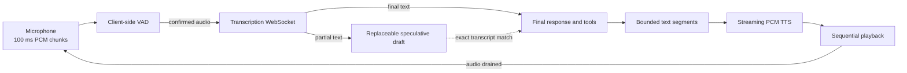

# Streaming Voice Assistant

[](https://github.com/Giuseppe0311/streaming-voice-assistant/actions/workflows/test.yml)

A local, half-duplex voice assistant built to explore how audio chunks move through an asynchronous Python system: microphone capture, streaming transcription, speculative LLM work, text-to-speech, and bounded playback.

This is intentionally **not** a full-duplex voice agent. It listens to one complete turn, stops the microphone, produces and plays the answer, and only then listens again. That constraint keeps echo, interruption, and concurrent device ownership out of the learning scope.

## What this project demonstrates

- PCM16 microphone audio captured in fixed 100 ms chunks.
- Audio sent incrementally to a transcription WebSocket.
- Partial transcripts available while the user is still speaking.
- Client-side voice activity detection with onset confirmation, silence detection, and hysteresis for soft fillers.
- Debounced speculative LLM requests that can be cancelled or reused safely.
- Strict function tools with validation, timeouts, and call limits.
- Text split into bounded phrases and converted to streaming PCM speech.
- Pull-based playback that provides natural backpressure.
- Explicit ownership and cleanup of microphones, sockets, provider streams, and audio devices.

## Architecture



The turn lifecycle is deliberately sequential:

```text
LISTENING → FINALIZING → THINKING → SPEAKING → LISTENING
```

The microphone is physically stopped before model/tool resolution and playback. It is reopened only after the output stream has fully drained.

## Understanding the chunks

Audio is mono, signed 16-bit PCM at 24 kHz.

```text
24,000 samples/second
× 2 bytes/sample
= 48,000 bytes/second
```

The microphone uses blocks of 2,400 samples:

```text
2,400 samples ÷ 24,000 samples/second = 0.1 second
2,400 samples × 2 bytes/sample = 4,800 bytes
```

Therefore, every input block represents **100 ms of audio** and occupies **4,800 bytes** before Base64 transport encoding.

The same 4,800-byte size is requested from the TTS byte iterator. For PCM16 at 24 kHz, each returned chunk also represents approximately 100 ms of output audio.

### Why fixed-size chunks matter

Chunks let the pipeline make progress without recording an entire utterance first:

1. PortAudio captures one 100 ms block.
2. The local VAD inspects its RMS energy.
3. Confirmed speech is appended to the provider audio buffer.
4. Transcription deltas update the current partial transcript.
5. After sustained silence, capture stops and the server buffer is committed.

Smaller chunks can reduce detection latency but increase callback, queue, and network overhead. Larger chunks reduce overhead but make the interaction less responsive. The 100 ms block is a simple, explicit trade-off for this prototype.

## What actually streams

The word *streaming* can hide important differences. This project is explicit about each boundary:

| Stage | Streaming behavior |
|---|---|
| Microphone | Produces 100 ms PCM blocks while the user speaks |
| Transcription | Receives audio append events and emits partial text deltas |
| LLM transport | Uses the Responses streaming API, but the application waits for `response.completed` |
| Tool resolution | Completes before any answer is spoken |
| TTS | Returns PCM bytes incrementally for each bounded text segment |
| Playback | Pulls and writes each PCM chunk sequentially |

### Does audio play while the LLM is still generating?

No. This implementation intentionally waits for the completed model response and any required tool outputs before sending text to TTS.

That choice prevents the assistant from speaking an intermediate statement that a later tool result could contradict. Once a final text segment is accepted, however, **TTS generation and playback are streamed**: playback can consume the first PCM chunks without waiting for the complete audio file.

The latency experiment in this project happens earlier. Partial transcripts can launch a private speculative LLM request while the user is still speaking. A draft is reused only when its source text exactly matches the authoritative final transcript.

## Backpressure and bounded memory

The pipeline avoids unbounded producers:

- The microphone queue is bounded to 30 chunks, or roughly three seconds of input audio.
- A queue overflow is treated as a fatal capture error instead of silently dropping speech.
- Every WebSocket send is awaited.
- TTS text segments are limited to 300 characters.
- Playback pulls the next TTS chunk only after it has processed the current one.
- Async generators are closed explicitly when a turn fails or is cancelled.

This pull-based flow is the key backpressure mechanism: a slow audio device naturally slows consumption instead of allowing an unlimited PCM backlog to grow.

## Speculative responses without speculative side effects

Partial transcripts change frequently. The `Drafts` coordinator keeps only one replaceable candidate:

1. A partial transcript changes.
2. A debounce window groups rapid updates.
3. Obsolete generation is cancelled.
4. The newest completed result is retained privately.
5. Finalization reuses it only on an exact text match.

A speculative response may propose a function call, but tools are never executed until the final transcript is known. This separates latency optimization from external side effects.

## Built-in tools

- `calculator`: add, subtract, multiply, or divide with typed arguments.
- `current_datetime`: return the current time for an IANA timezone.

Tool arguments are validated with strict Pydantic models. Unknown tools, invalid arguments, timeouts, non-JSON results, and call-budget exhaustion become structured failures instead of uncaught model behavior.

## Quick start

### Requirements

- Python 3.11+
- A microphone and speakers
- PortAudio available to `sounddevice`
- An OpenAI API key and access to the configured models

### Install

```bash
git clone https://github.com/Giuseppe0311/streaming-voice-assistant.git
cd streaming-voice-assistant

python3 -m venv .venv
source .venv/bin/activate
python -m pip install -e '.[test]'

cp .env.example .env
```

Add your API key to `.env`, then start one process without auto-reload:

```bash
python -m uvicorn app.main:app --host 127.0.0.1 --port 8000
```

The application reads `VOICE_ENABLED=true` from `.env`. Speak normally, pause, and wait for the answer. Press `Ctrl+C` to release the devices.

> Voice mode sends audio and text to OpenAI and may incur charges. The generated voice is AI-generated. Do not speak secrets.

### Safe HTTP-only mode

Set `VOICE_ENABLED=false` or omit it to run the API without opening audio devices or provider clients:

```bash
python -m uvicorn app.main:app --host 127.0.0.1 --port 8000
```

- `GET /health` reports voice state and a sanitized failure stage.
- `GET /conversation` exposes the current local transcript and last response.

Keep the service bound to `127.0.0.1`. These endpoints are intentionally unauthenticated and may expose private transcript text.

## Configuration

| Variable | Default | Purpose |
|---|---|---|
| `VOICE_ENABLED` | `false` | Explicitly enables microphone and paid provider calls |
| `TRANSCRIPTION_MODEL` | `gpt-live-transcribe` | Streaming speech-to-text model |
| `LLM_MODEL` | `gpt-5.6-luna` | Responses model with function-tool support |
| `TTS_MODEL` | `gpt-4o-mini-tts` | Text-to-speech model |
| `TTS_VOICE` | `coral` | Generated voice |
| `SILENCE_SECONDS` | `1.3` | Quiet period that finalizes a turn |
| `VAD_THRESHOLD` | `0.015` | RMS energy required to start speech |
| `VAD_RELEASE_RATIO` | `0.5` | Lower continuation threshold after speech is confirmed |
| `MIN_SPEECH_SECONDS` | `0.2` | Required speech before a turn can end |
| `MAX_TURN_SECONDS` | `60` | Maximum duration after speech starts |
| `SPECULATIVE_ENABLED` | `true` | Allows private LLM work from partial transcripts |
| `DRAFT_DELAY` | `0.6` | Debounce window for partial transcript updates |
| `REQUEST_TIMEOUT` | `30` | Provider and final transcript timeout |
| `TOOL_TIMEOUT` | `5` | Maximum tool execution time |
| `MAX_TOOL_CALLS` | `4` | Tool-call budget per final response |
| `HISTORY_TURNS` | `10` | Completed exchanges kept in memory |
| `INPUT_DEVICE` | system default | Optional PortAudio input device index |
| `OUTPUT_DEVICE` | system default | Optional PortAudio output device index |

Existing shell variables take precedence over `.env`. Importing `app.main` alone does not load credentials or open audio devices.

## Project structure

```text
app/
  main.py                 # Dependency composition and safe lifespan
  config.py               # Validated environment settings
  api/routes.py           # Local health and transcript inspection
  audio/                  # Capture, VAD, blocking-I/O bridge, playback
  conversation/           # Turn lifecycle and speculative drafts
  providers/              # Transcription, Responses, and speech adapters
  tools/                  # Typed registry, execution, and built-ins
tests/
  unit/                   # VAD, drafts, providers, tools, and transport
  integration/            # Whole-turn ordering, cancellation, cleanup
```

## Tests

```bash
python -B -m pytest -p no:cacheprovider -q
```

The automated suite uses fake providers, microphones, sockets, and PortAudio streams. It requires no API key, network, microphone, or speakers.

Coverage includes:

- VAD onset, silence, soft fillers, and false starts.
- Partial transcript draft replacement and cancellation.
- Final-only tool execution and strict validation.
- Audio commit ordering and final transcript handling.
- TTS chunk alignment and playback drain.
- Stream ownership, cancellation, and cleanup failures.
- Safe application startup without credentials or devices.

## Important limitations

- Half-duplex only: there is no barge-in or simultaneous listening and speaking.
- Energy-based VAD cannot distinguish speech from every environmental sound.
- Model text is buffered until tools are resolved; token deltas are not spoken directly.
- Conversation history is bounded and in memory only.
- Provider and audio failures stop the voice loop and require a process restart.
- The local HTTP inspection API has no authentication.

## Learning takeaways

The main lesson is that streaming is not one feature. It is a chain of ownership boundaries:

- Who creates each chunk?
- Who is allowed to buffer it?
- What happens when the consumer is slower?
- Which provisional results may be cancelled?
- When is it safe to perform a side effect?
- Who closes the stream after failure or cancellation?

The code favors explicit answers to those questions over framework abstraction. That makes the project useful as a compact study of asynchronous audio pipelines, rather than only another voice API demo.

## References

- [OpenAI Realtime transcription](https://developers.openai.com/api/docs/guides/realtime-transcription)
- [OpenAI function calling](https://developers.openai.com/api/docs/guides/function-calling)
- [OpenAI text-to-speech](https://developers.openai.com/api/docs/guides/text-to-speech)
- [Python asynchronous generators](https://docs.python.org/3/reference/expressions.html#asynchronous-generator-functions)
